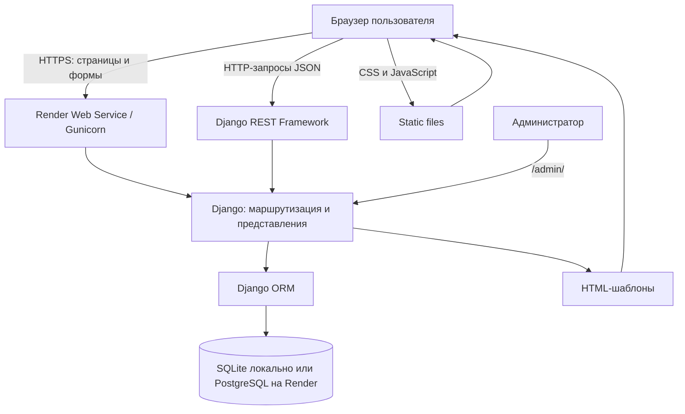

# Архитектура BookTracer

## Границы компонентов

1. **Браузер** отображает HTML, CSS и JavaScript и отправляет запросы.
2. **Render Web Service** запускает приложение через Gunicorn. На локальном компьютере используется `runserver` либо Docker Compose.
3. **Django** обрабатывает URL, HTML-страницы, сессии и права доступа.
4. **Django REST Framework** обслуживает `/api/...`, проверяет данные сериализаторами и возвращает JSON.
5. **Django ORM** переводит операции с моделями в запросы к выбранной СУБД.
6. **SQLite** используется, когда `DATABASE_URL` не задан. При заданном `DATABASE_URL` приложение подключается к указанной базе, например PostgreSQL Render.
7. **Статические файлы** хранятся в `static/`; команда `collectstatic` собирает их в `staticfiles/`, а WhiteNoise обслуживает собранную статику.

## Потоки данных

- Каталог: браузер → `/api/books/` → `api_book_list` → `Book`/`Author`/`Genre` → JSON.
- Личный список: авторизованный браузер → `/api/my-book-statuses/` → фильтрация по `request.user` → JSON.
- Бронирование: авторизованный браузер → `/api/reservations/` → сериализатор и транзакция → `BookReservation` и `ReservationEvent`.
- Администрирование: `/admin/` → Django Admin → модели и база данных.

Примечание: локальная и облачная базы — отдельные хранилища. Совпадение схемы после миграций не означает совпадения записей.
