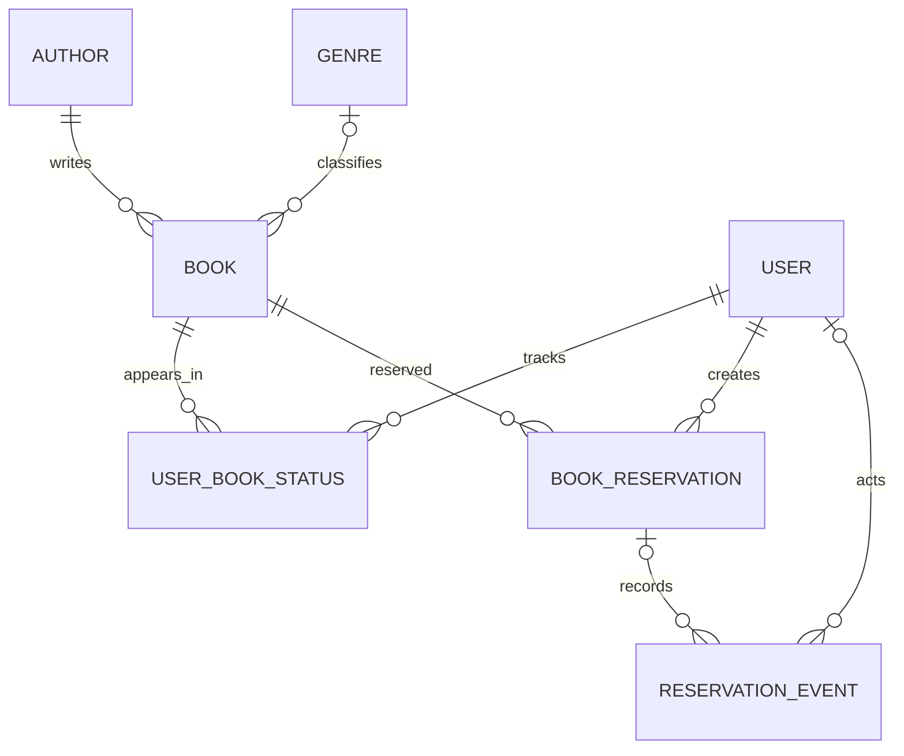

# Модели базы данных

## Сущности и ключевые поля

| Модель | Основные поля | Назначение |
|---|---|---|
| `Author` | `id`, `name` | Автор книги |
| `Genre` | `id`, `name` | Жанр |
| `Book` | `id`, `title`, `description`, `snippet`, `available_copies`, `author_id`, `genre_id` | Книга, описание, фрагмент и доступный остаток |
| `UserBookStatus` | `id`, `user_id`, `book_id`, `status`, `is_favorite` | Статус чтения и избранное пользователя |
| `BookReservation` | `id`, `book_id`, `user_id`, `status`, `created_at`, `updated_at` | Бронирование книги пользователем |
| `ReservationEvent` | `id`, `reservation_id`, `reservation_id_snapshot`, `actor_id`, `event_type`, `details`, `created_at` | История событий бронирования |

## Связи

- Один автор может быть связан с несколькими книгами. Удаление автора удаляет связанные книги (`CASCADE`).
- Жанр у книги необязательный; при удалении жанра книга сохраняется (`SET_NULL`).
- Для пары пользователь–книга в `UserBookStatus` действует уникальность `unique_together`: дубликаты не допускаются.
- Бронирование принадлежит одному пользователю и одной книге.
- `ReservationEvent` хранит журнал событий; связь с бронированием может быть пустой, чтобы сохранить событие удаления. `reservation_id_snapshot` сохраняет номер удалённого бронирования.

## Допустимые статусы

- Чтение: `to_read` → `reading` → `read`. В сериализаторе переход назад не разрешён.
- Бронирование: `created`, `confirmed`, `issued`, `returned`, `cancelled`. Действия доступны через API маршрута `/api/reservations/<id>/action/`; допустимость перехода проверяется сервером.

Миграции в `library/migrations/` описывают изменение схемы. Команда `python manage.py migrate` создаёт/обновляет таблицы, но не переносит данные из другой базы.
